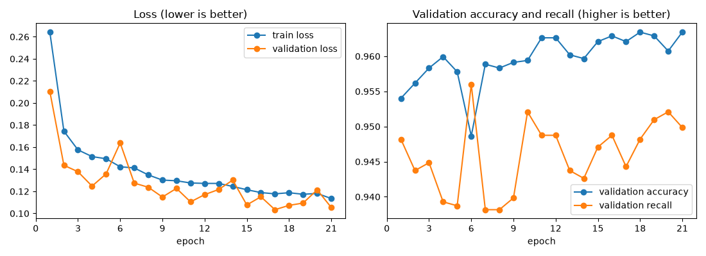
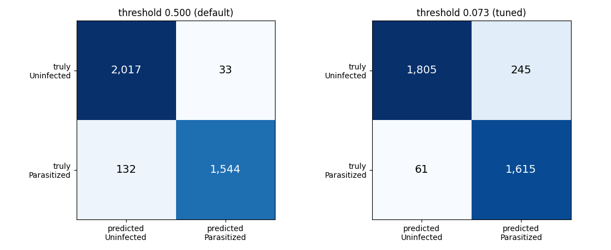
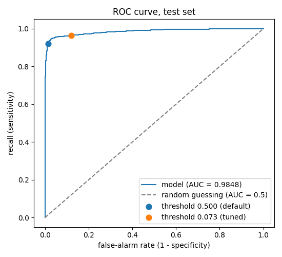
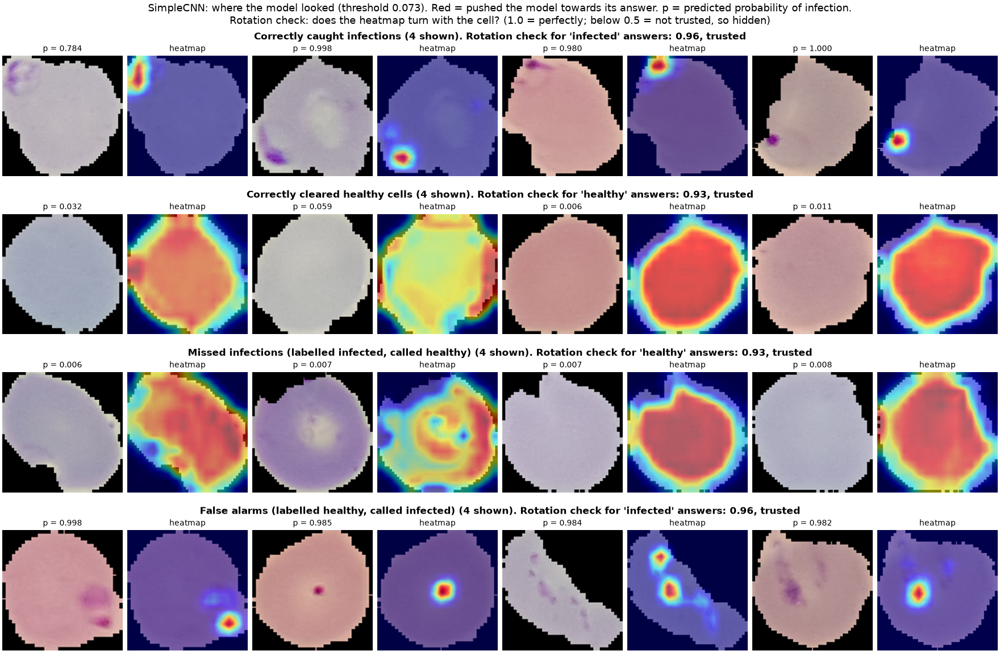

# Malaria Cell Classifier

*Made with ❤️ by Calli · Part of the AI for Engineers Coursework*

A convolutional neural network (CNN) that looks at a microscope image of **one red blood cell** and says whether it is **Parasitized** (malaria-infected) or **Uninfected** (healthy).

> **Problem statement (Biocon Ltd.):** Biocon is working on automated diagnosis of blood samples. Develop a CNN model to classify red blood cell images as healthy or malaria-infected, supporting faster and more accurate medical diagnostics.

## Results at a glance

**SimpleCNN**, a small CNN built from scratch, tested **once** on **3,726 cells from 29 patients** that it never trained on. The decision threshold was tuned on separate *validation* patients to catch at least 98% of infected cells, because **a missed infection is far worse than a false alarm**.

| | SimpleCNN @ tuned threshold (0.073) |
|---|---|
| **Recall** (infected cells caught) | **96.36%** (1,615 of 1,676) |
| **Specificity** (healthy cells cleared) | 88.05% (1,805 of 2,050) |
| Missed infections | 61 of 1,676 |
| False alarms | 245 of 2,050 |
| ROC-AUC | 0.9848 |
| Size of the weights | 1.6 MB (389,153 parameters) |

**In one sentence:** the model catches about 96 of every 100 infected cells, and when it calls a cell infected it looks at the purple stained parasite (see [Explainability](#explainability-where-does-the-model-look)).

All model results in this README come from the files in [`results/`](results/), produced by a real Kaggle run (and reproduced exactly on a laptop). Dataset facts come from [`notebooks/01_explore_data.ipynb`](notebooks/01_explore_data.ipynb), run on Kaggle.

---

## Contents
- [The problem](#the-problem)
- [Dataset](#dataset)
- [Approach](#approach)
- [Results](#results)
- [Explainability: where does the model look?](#explainability-where-does-the-model-look)
- [How to run it](#how-to-run-it)
- [Trained weights](#trained-weights)
- [Limitations](#limitations)
- [Future work](#future-work)
- [Project structure](#project-structure)

---

## The problem

- **Input:** a colour microscope image of a single red blood cell from a stained thin blood smear.
- **Output:** *Parasitized* or *Uninfected*, plus the probability of infection.
- **Why it matters:** the model can be wrong in two ways, and they are not equally bad:

| Mistake | Meaning | How bad? |
|---|---|---|
| **False negative** (missed infection) | an infected cell called healthy | **Very bad:** a sick patient could go untreated |
| **False positive** (false alarm) | a healthy cell called infected | Annoying: a human re-checks it |

So we care most about **recall** (sensitivity), and deliberately lower the decision threshold to raise it.

## Dataset

**NIH Malaria Cell Images**, from the U.S. National Library of Medicine (Lister Hill National Center for Biomedical Communications), hosted on Kaggle as [`iarunava/cell-images-for-detecting-malaria`](https://www.kaggle.com/datasets/iarunava/cell-images-for-detecting-malaria). It was introduced in: Rajaraman S. et al., *"Pre-trained convolutional neural networks as feature extractors toward improved malaria parasite detection in thin blood smear images"*, PeerJ (2018).

What we found when we checked it ([`notebooks/01_explore_data.ipynb`](notebooks/01_explore_data.ipynb)):

| | |
|---|---|
| Unique images | **27,558**: exactly 13,779 Parasitized and 13,779 Uninfected |
| Duplicates | the Kaggle upload contains every image **twice** (a nested `cell_images/cell_images/` folder), plus 4 `Thumbs.db` junk files; duplicates are removed by file fingerprint (hash) |
| Image sizes | 40 to 394 pixels per side, median 130 |
| Patients | **200**, identified by the `C<number>` at the start of each filename; this matches the dataset's ~150 infected and ~50 healthy patients |

## Approach

**1. Split by patient, never by image.** Many cells come from the same patient's slide. If one patient's cells were in both training and test sets, a model could recognise the *slide* (stain colour, lighting) instead of the parasite, and the test score would lie. So every patient goes to exactly one split, using scikit-learn's `StratifiedGroupKFold` (which also keeps the infected/healthy mix similar in each split). The split is saved in [`splits/splits.csv`](splits/splits.csv) and reused by every run.

| Split | Images | Patients | Used for |
|---|---|---|---|
| Train | 20,113 | 143 | learning the weights |
| Validation | 3,719 | 28 | choosing the best epoch and the threshold |
| Test | 3,726 | 29 | measured **once**, at the end |

**2. The model: SimpleCNN** ([`src/models.py`](src/models.py)), trained with an explicit PyTorch training loop (no high-level wrappers): 4 blocks of *convolution → BatchNorm → ReLU → max-pooling* (32 → 64 → 128 → 256 filters), global average pooling, dropout 0.3, one output. 128×128 input, 389,153 parameters. Adam (learning rate 1e-3).

Training uses data augmentation (flips, rotations of up to 180°, mild colour jitter) on training images only; binary cross-entropy loss; a learning-rate scheduler that halves the rate when validation loss stalls; and early stopping, keeping the epoch with the lowest validation loss.

**3. Honest evaluation** ([`src/evaluate.py`](src/evaluate.py)). On the *validation* set, choose the highest threshold that still catches at least 98% of infected cells. Then measure the *test* set at both the default threshold (0.5) and the tuned one. Nothing is ever chosen by looking at test results.

**4. Explainability** ([`src/gradcam.py`](src/gradcam.py)): Grad-CAM heatmaps show where in the cell the model looked, and a *rotation check* tests whether each kind of heatmap can be trusted.

## Results

### Training

Best epoch 17 of 21; training took 12.5 minutes on a Tesla T4 GPU.



Training and validation loss fall together, with no widening gap, so there is no sign of overfitting. The run was ended by early stopping.

### Test set: the threshold trade-off

| | SimpleCNN @ 0.5 (default) | SimpleCNN @ 0.073 (tuned) |
|---|---|---|
| Accuracy | 95.57% | 91.79% |
| Precision | 97.91% | 86.83% |
| Recall | 92.12% | 96.36% |
| Specificity | 98.39% | 88.05% |
| F1 | 0.9493 | 0.9135 |
| Missed infections | 132 | 61 |
| False alarms | 33 | 245 |

- **Lowering the threshold trades false alarms for caught infections.** It halved the missed infections (132 → 61), at the cost of about 7× more false alarms (33 → 245).
- **Test recall (96.36%) landed below the 98% target** that the model reached on validation (98.05%). That gap is the honest answer to "how does it do on *new* patients?", and we report it as it is.

| Confusion matrices | ROC curve |
|---|---|
|  |  |

## Explainability: where does the model look?

Grad-CAM produces a heatmap of the parts of the image that pushed the model towards its answer (red = strongest).

**Can the heatmaps be trusted?** We tested them with a **rotation check**: rotate a cell 180°, and a heatmap that really shows something *in the cell* must turn with it. On 100 test cells per answer ([`results/gradcam_checks.json`](results/gradcam_checks.json); 1.0 = turns perfectly with the cell):

| | "why infected?" | "why healthy?" |
|---|---|---|
| SimpleCNN | 0.96 ✓ | 0.93 ✓ |

Both kinds of heatmap pass, so both are shown.

**What the heatmaps show:**
- **When the model calls a cell infected, it looks at the purple stained parasite.** That's what we'd hope for.
- **"Why healthy?"** heatmaps spread over the body of the cell: "no spot anywhere".
- **False alarms:** the model fires on purple spots in cells *labelled* healthy.
- **Missed infections:** most of these "infected" cells show no clear parasite at all.



More: [`results/simple_cnn_misclassified.png`](results/simple_cnn_misclassified.png).

## How to run it

### Setup (laptop)

```bash
git clone https://github.com/CallidusK/malaria-cnn.git
cd malaria-cnn
python3 -m venv .venv
source .venv/bin/activate
pip install -r requirements.txt
```

### Classify cells with a trained model

Get the weights first (see [Trained weights](#trained-weights)), and put them in `outputs/`.

```bash
# One cell
python -m src.predict --weights outputs/simple_cnn_best.pt --image my_cell.png

# A folder of cells, saved to a CSV file
python -m src.predict --weights outputs/simple_cnn_best.pt --folder my_cells/ --output-csv predictions.csv
```

It uses the model's tuned threshold from `results/` (add `--threshold 0.5` to override), and prints the decision and the probability of infection for each image. Images should show **one** cell each, like the dataset's.

### Quick checks on the laptop (no real data or GPU needed)

```bash
python -m src.make_fake_data              # a tiny fake dataset of cartoon cells
pytest                                    # all automatic tests
python -m src.train --overfit-batch       # sanity check: can the model memorise 16 cells?
python -m src.train --smoke-test          # 1 epoch on the fake data
python -m src.evaluate --smoke-test
```

### Real training and evaluation (Kaggle, free GPU)

1. Pack the committed code: `git archive --format=zip --prefix=malaria-cnn/ -o malaria-cnn-code.zip HEAD`
2. On Kaggle: **Datasets → New Dataset**, upload the zip (private).
3. Import [`notebooks/02_run_on_kaggle.ipynb`](notebooks/02_run_on_kaggle.ipynb) as a new notebook. Turn on **GPU**. **Add Input:** your code dataset and `cell-images-for-detecting-malaria`.
4. **Run All**. It trains, evaluates, and zips every output for download.

On a Tesla T4, training took 12.5 minutes.

### Grad-CAM (laptop, with the real data)

Download the dataset from Kaggle and copy its `cell_images/Parasitized` and `cell_images/Uninfected` folders to `data/real/datasets/iarunava/cell-images-for-detecting-malaria/cell_images/`, so the paths in `splits/splits.csv` match. Then:

```bash
python -m src.gradcam --data-dir data/real
```

## Trained weights

Model weights are not stored in the repository itself. They are published as a **GitHub Release**: [`v1.0`](https://github.com/CallidusK/malaria-cnn/releases/tag/v1.0).

| File | Size |
|---|---|
| `simple_cnn_best.pt` | 1.6 MB |

**To use it:** download it from the [releases page](https://github.com/CallidusK/malaria-cnn/releases) into `outputs/`.

## Limitations

- **Single cells only.** The model needs images that each show one already-cut-out cell. A real smear image would first need a step that finds and crops every cell, which this project doesn't include.
- **Cell-level, not patient-level.** A diagnosis is about a *patient*, who has thousands of cells; these scores are per cell.
- **Many false alarms at the tuned threshold.** Catching 96% of infections costs 245 false alarms out of 2,050 healthy cells, so a human would re-check a lot of cells.
- **Possible label errors.** Several "missed infections" show no visible parasite, and several "false alarms" show clear purple spots. Some measured "errors" may be labelling mistakes, but only an expert could confirm which. We did **not** remove or relabel anything.
- **Small test set, in patients.** 29 test patients is enough to see large effects, but small differences in the scores could be chance.
- **Recall on new patients missed the target.** The threshold reached 98% recall on validation patients, but 96.4% on test patients.
- **One dataset, one source.** All images come from one collection. Performance on slides from another lab, microscope or stain is unknown.
- **Speed not measured.** How fast it runs on a laptop CPU (a likely clinic setting) is unknown.
- **Explanations have limits.** Heatmaps show *where* the model looked, not *why* that region mattered.

## Future work

- **Patient-level diagnosis:** combine the predictions for all of a patient's cells into one decision, and measure accuracy per patient.
- **Expert review of disputed labels:** have a microscopist re-examine the cells the model confidently disagrees with.
- **Fewer false alarms:** try other architectures, or more training data, to separate the two classes more cleanly, and measure speed on a laptop CPU.
- **External validation** on cells from a different dataset, such as BBBC041, to test how well the model transfers to other labs.
- **A simple demo app** (e.g. Gradio): upload a cell image, see the prediction and its heatmap.

## Project structure

```
malaria-cnn/
├── README.md                     this file
├── PLAN.md                       the project plan, phase by phase
├── requirements.txt              laptop dependencies
├── requirements-kaggle.txt       extras Kaggle doesn't have
├── src/
│   ├── config.py                 every setting in one place
│   ├── utils.py                  random seeds, choosing CPU/GPU
│   ├── make_fake_data.py         tiny fake dataset for local tests
│   ├── data.py                   find images, remove duplicates, split by patient, DataLoaders
│   ├── models.py                 SimpleCNN, our CNN
│   ├── train.py                  explicit training loop, early stopping
│   ├── evaluate.py               test metrics, threshold tuning, plots
│   ├── gradcam.py                Grad-CAM heatmaps and the rotation check
│   └── predict.py                classify images from the command line
├── notebooks/
│   ├── 01_explore_data.ipynb     looking at the data first
│   └── 02_run_on_kaggle.ipynb    training and evaluation on Kaggle
├── tests/                        automatic checks (run with `pytest`)
├── splits/splits.csv             the saved train/val/test split
├── results/                      metrics, plots and heatmaps from the real runs
└── docs/learning_notes.md        plain-English notes on every concept used
```

## Acknowledgements

- Dataset: U.S. National Library of Medicine, Lister Hill National Center for Biomedical Communications (NIH Malaria Cell Images).
- Built with PyTorch, torchvision, scikit-learn, pandas, Matplotlib and [pytorch-grad-cam](https://github.com/jacobgil/pytorch-grad-cam).
